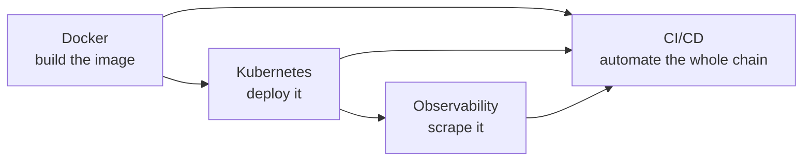

# Capstone: ship a monitored service

Every other topic in this repo is a strong *reference* — notes plus one isolated,
CI-validated example. This one is different: it's a single walkthrough that chains four
of those topics together, to show that the pieces actually click — not just that each
one works in isolation.

## What this is (and isn't)

- **Is**: one doc that builds `topics/docker/examples/hello-nginx`, shows the manifests
  to deploy it to a local `kind` cluster with an `nginx-prometheus-exporter` sidecar for
  a real scraped metric, and the GitHub Actions workflow that would automate all of that
  on every merge.
- **Isn't**: a new category of CI-validated example. It intentionally reuses and adapts
  `topics/docker/`, `topics/kubernetes/`, `topics/observability/`, and `topics/cicd/`'s
  existing examples rather than shipping a fifth copy of the same Dockerfile/Deployment
  pattern — every manifest here is a small, explained variant of something those topics
  already cover in depth. There's no `examples/` directory under this topic for that
  reason; go read the topic a step belongs to for the full explanation of *why* it works,
  this doc only covers *how it connects*.

## Contents

- `notes/01-ship-a-monitored-service.md` — the walkthrough itself.

The Docker build and every manifest's schema have been verified for real; the note's own
"what was actually verified" callout says exactly what was and wasn't run live, and why
(this piece isn't wired into `validate.yml` the same way a topic's own examples are —
standing up a `kind` cluster plus a Prometheus scrape target for one doc isn't worth a
permanent CI job the way the per-topic live checks are).
