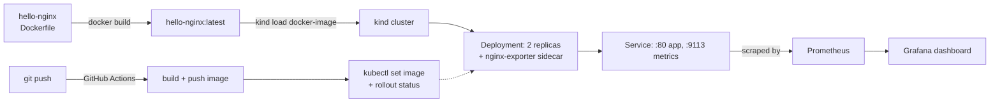

# Ship a monitored service

Four topics, one small service, start to finish: build it, deploy it, watch it, automate
it. Every manifest below is a deliberately small variant of something those topics
already explain in depth — this doc links to that explanation rather than repeating it,
and focuses on how the pieces connect.



## 1. Docker — build the image

Reuse `topics/docker/examples/hello-nginx` as-is; see `topics/docker/notes/01-images-and-dockerfiles.md`
for what's actually in it.

```bash
docker build -t hello-nginx:latest topics/docker/examples/hello-nginx
docker run -d --name hello-nginx-check -p 8080:80 hello-nginx:latest
curl http://localhost:8080   # -> "hello from the cookbook"
docker rm -f hello-nginx-check
```

## 2. Kubernetes — deploy it, with a metrics sidecar

A locally-built image isn't in any registry, so a `kind` cluster needs it loaded
directly rather than pulled — see `topics/kubernetes/notes/01-kubectl-commands.md` for
the rest of the `kubectl`/`kind` vocabulary this assumes:

```bash
kind create cluster
kind load docker-image hello-nginx:latest
```

The Deployment adds one thing beyond `topics/kubernetes/examples/deployment/sample-deployment.yaml`:
a second container in the same Pod (an `nginx-prometheus-exporter` sidecar, sharing the
Pod's network namespace — see `topics/kubernetes/notes/02-pods-and-workloads.md` on why
most Pods run one container, and this is the deliberate exception) that scrapes nginx's
built-in `stub_status` page and re-exposes it in Prometheus's format. The `stub_status`
endpoint itself comes from a `ConfigMap`-mounted nginx config fragment — the same
env-var/volume-mount pattern as `topics/kubernetes/notes/03-config-and-secrets.md`,
just mounting a config snippet instead of injecting a value:

```yaml
apiVersion: v1
kind: ConfigMap
metadata:
  name: nginx-stub-status
data:
  stub-status.conf: |
    server {
        listen 8081;
        location /stub_status {
            stub_status;
        }
    }
---
apiVersion: apps/v1
kind: Deployment
metadata:
  name: capstone-app
spec:
  replicas: 2
  selector:
    matchLabels:
      app: capstone-app
  template:
    metadata:
      labels:
        app: capstone-app
    spec:
      containers:
        - name: hello-nginx
          image: hello-nginx:latest
          imagePullPolicy: IfNotPresent
          ports:
            - containerPort: 80
            - containerPort: 8081
          volumeMounts:
            - name: stub-status
              mountPath: /etc/nginx/conf.d/stub-status.conf
              subPath: stub-status.conf
        - name: nginx-exporter
          image: nginx/nginx-prometheus-exporter:1.3
          args:
            - -nginx.scrape-uri=http://localhost:8081/stub_status
          ports:
            - containerPort: 9113
      volumes:
        - name: stub-status
          configMap:
            name: nginx-stub-status
---
apiVersion: v1
kind: Service
metadata:
  name: capstone-app
spec:
  selector:
    app: capstone-app
  ports:
    - name: http
      port: 80
      targetPort: 80
    - name: metrics
      port: 9113
      targetPort: 9113
```

```bash
kubectl apply -f capstone.yaml   # the three documents above, saved to one file
kubectl wait --for=condition=available --timeout=60s deployment/capstone-app
kubectl get pods -l app=capstone-app   # 2/2 Running — both containers in each Pod
```

## 3. Observability — scrape it for real

```bash
kubectl port-forward svc/capstone-app 9113:9113 &
curl -s localhost:9113/metrics | grep nginx_http_requests_total
# nginx_http_requests_total 1
```

That's a real metric off a real request count — not a mocked example. Add it as a
scrape target the same way `topics/observability/examples/prometheus/prometheus.yml`
already defines one:

```yaml
scrape_configs:
  - job_name: capstone-app
    static_configs:
      - targets: ["localhost:9113"]
```

With that running, `rate(nginx_http_requests_total[5m])` in Prometheus (see
`topics/observability/notes/01-prometheus-basics.md` for what `rate()` is doing there)
is the request-rate panel on a Grafana dashboard shaped like
`topics/observability/examples/grafana/dashboard.json`.

## 4. CI/CD — automate the whole chain

The four manual steps above become one workflow, triggered on every push that touches
the app: build, push to a registry, then update the running Deployment — the rolling
update behavior from `topics/cicd/notes/03-deployment-strategies.md` takes it from
there.

```yaml
name: Build and deploy capstone-app

on:
  push:
    branches: [main]
    paths: ["app/**"]

permissions:
  contents: read
  packages: write

jobs:
  build-and-push:
    runs-on: ubuntu-latest
    outputs:
      image: ${{ steps.meta.outputs.image }}
    steps:
      - uses: actions/checkout@v4
      - uses: docker/login-action@v3
        with:
          registry: ghcr.io
          username: ${{ github.actor }}
          password: ${{ secrets.GITHUB_TOKEN }}
      - id: meta
        env:
          IMAGE: ghcr.io/${{ github.repository }}/capstone-app:${{ github.sha }}
        run: |
          docker build -t "$IMAGE" app/
          docker push "$IMAGE"
          echo "image=$IMAGE" >> "$GITHUB_OUTPUT"

  deploy:
    needs: build-and-push
    runs-on: ubuntu-latest
    environment: production
    steps:
      - uses: actions/checkout@v4
      - run: |
          kubectl set image deployment/capstone-app \
            hello-nginx="${{ needs.build-and-push.outputs.image }}"
          kubectl rollout status deployment/capstone-app
```

`environment: production` on the `deploy` job is what lets a repo require manual
approval before that job runs — see `topics/cicd/notes/03-deployment-strategies.md`'s
section on environments and promotion.

## What was actually verified

Every command above was run for real, piece by piece, rather than just written once and
left to rot — same bar as the rest of this repo:

- The Docker build/run/curl sequence ran against a live Docker daemon (`docker build`,
  `docker run`, a real `curl` returning the expected page).
- All three Kubernetes manifests passed `kubeconform -strict` (schema-valid, same check
  `validate.yml` runs on every other manifest in this repo).
- The Prometheus scrape addition passed `promtool check config`.
- The GitHub Actions workflow passed `actionlint`.

What wasn't verified live: the `kubectl apply` → `port-forward` → scrape sequence in
steps 2–3. A `kind` cluster is exactly what `topics/kubernetes/`'s own CI uses, but
standing one up in a sandboxed environment doesn't always succeed (nested containers can
fail at the `kubeadm` control-plane step depending on the host's cgroup setup) — that's
what happened writing this doc. The manifests are schema-valid and follow the identical
sidecar/ConfigMap-mount pattern `topics/kubernetes/notes/02-pods-and-workloads.md` and
`topics/kubernetes/notes/03-config-and-secrets.md` already demonstrate working, but if you hit something
different running this for real on a working `kind` setup, please open an issue —
that gap is exactly what this callout is flagging rather than papering over.
